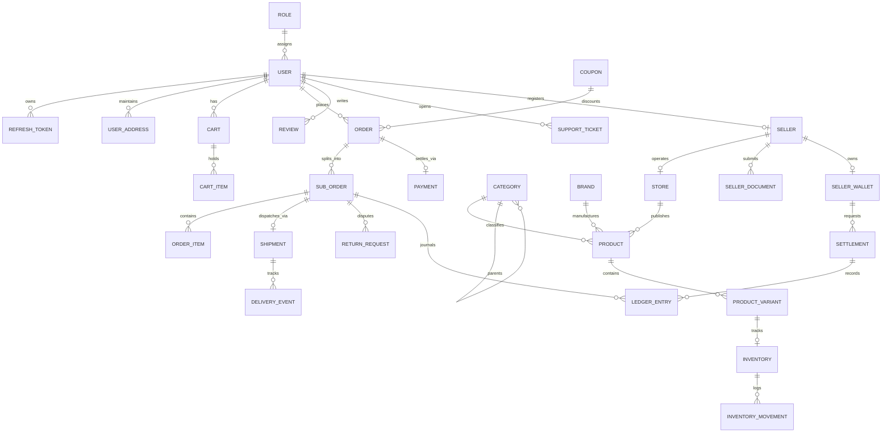

# Database Schema & Entity-Relationship (ER) Specification
## Enterprise Multi-Vendor E-Commerce Marketplace
**Document Version:** 1.0.0  
**Database Engine:** MongoDB 6.0+ with Mongoose ODM  
**Transaction Support:** Multi-Document ACID Transactions (Replica Set)  

---

## 1. Database Architecture & Modeling Principles

The database layer is engineered in **MongoDB** using **Mongoose ODM**. It balances document-oriented embedding (for read performance and atomic updates) with relational referencing (for global consistency, tenant isolation, and auditability).

### Core Design Rules
1. **Immutable Historical Snapshots**:
   - Order items, sub-orders, parent orders, and transactions **never reference mutable catalog prices or mutable commission policies**.
   - All monetary figures (prices, discounts, taxes, shipping fees, commission rates, and seller earnings) are frozen as immutable embedded snapshots at checkout creation.
2. **Double-Entry Financial Ledger**:
   - Wallets are materialized projections. The single source of financial truth is the append-only `ledgerEntries` collection.
3. **Atomic Stock & Reservation Invariant**:
   - Available stock and reserved stock are managed in an isolated `inventory` collection using conditional atomic operations:
     `{ $inc: { availableStock: -qty, reservedStock: qty } }` with query `{ sku: sku, availableStock: { $gte: qty } }`.
4. **Tenant Isolation**:
   - Every collection containing vendor data enforces a mandatory `storeId` and `sellerId` index to guarantee that data leaks between independent sellers are architecturally impossible.

---

## 2. Entity-Relationship (ER) Diagram



---

## 3. Detailed Collection Schemas

---

### 3.1 Identity, Access Control & Users

#### 3.1.1 `users`
Represents all system actors (customers, sellers, staff, administrators).

| Field Name | Type | Constraints / Attributes | Description |
| :--- | :--- | :--- | :--- |
| `_id` | ObjectId | Primary Key | System user identifier. |
| `firstName` | String | Required, Trim, Max: 50 | User first name. |
| `lastName` | String | Required, Trim, Max: 50 | User last name. |
| `email` | String | Required, Unique, Lowercase | Unique login email. |
| `phone` | String | Sparse, Unique, Trim | Mobile phone number (+880 format). |
| `passwordHash` | String | Required | Bcrypt hash (salt rounds $\ge 12$). |
| `roleId` | ObjectId | Required, Ref: `roles` | Assigned RBAC role. |
| `avatarUrl` | String | Optional | Cloudinary image URL. |
| `status` | String | Enum: `ACTIVE`, `PENDING_VERIFICATION`, `SUSPENDED`, `BANNED` | Account status. |
| `emailVerified` | Boolean | Default: false | Verification flag. |
| `phoneVerified` | Boolean | Default: false | Mobile verification flag. |
| `twoFactorEnabled` | Boolean | Default: false | TOTP 2FA flag. |
| `twoFactorSecret` | String | Select: false | Encrypted TOTP secret. |
| `lastLoginAt` | Date | Optional | Timestamp of last authentication. |
| `createdAt` | Date | Auto Timestamp | Record creation time. |
| `updatedAt` | Date | Auto Timestamp | Record update time. |

*Indexes:*
- `{ email: 1 }` (Unique)
- `{ phone: 1 }` (Unique, Sparse)
- `{ roleId: 1, status: 1 }` (Compound)

---

#### 3.1.2 `roles` & `permissions`
Governs granular server-side authorization.

```typescript
// roles collection
{
  _id: ObjectId,
  name: "SUPER_ADMIN" | "ADMIN" | "PRODUCT_MANAGER" | "ORDER_MANAGER" | "FINANCE_MANAGER" | "SUPPORT_AGENT" | "SELLER" | "CUSTOMER",
  description: String,
  isSystem: Boolean, // System roles cannot be deleted
  permissions: [String], // e.g. ["catalog:read", "products:create", "settlements:approve"]
  createdAt: Date,
  updatedAt: Date
}
```

---

#### 3.1.3 `userAddresses`
Customer delivery and billing address book.

| Field Name | Type | Constraints | Description |
| :--- | :--- | :--- | :--- |
| `_id` | ObjectId | Primary Key | Address ID. |
| `userId` | ObjectId | Required, Ref: `users` | Owner customer ID. |
| `type` | String | Enum: `SHIPPING`, `BILLING`, `BOTH` | Address classification. |
| `recipientName`| String | Required | Contact name at destination. |
| `phone` | String | Required | Delivery phone number. |
| `streetAddress`| String | Required | House, road, area details. |
| `city` | String | Required | City / District (e.g., Dhaka). |
| `division` | String | Required | Division / State. |
| `postalCode` | String | Required | Postal / ZIP code. |
| `isDefault` | Boolean | Default: false | Primary shipping address marker. |
| `deliveryNotes`| String | Optional | Instructions (e.g., "Leave with guard"). |

*Indexes:*
- `{ userId: 1, isDefault: -1 }` (Compound)

---

#### 3.1.4 `refreshTokens`
Maintains cryptographic token rotation and session revocation.

| Field Name | Type | Constraints | Description |
| :--- | :--- | :--- | :--- |
| `_id` | ObjectId | Primary Key | Token record ID. |
| `userId` | ObjectId | Required, Ref: `users` | Authenticated user. |
| `tokenHash` | String | Required, Unique | SHA-256 hash of refresh token. |
| `family` | String | Required | Token family UUID (for breach detection). |
| `userAgent` | String | Optional | Browser / device client header. |
| `ipAddress` | String | Optional | Client IP address. |
| `revoked` | Boolean | Default: false | Revocation flag. |
| `expiresAt` | Date | Required | Expiration timestamp. |
| `createdAt` | Date | Auto Timestamp | Issued at. |

*Indexes:*
- `{ tokenHash: 1 }` (Unique)
- `{ userId: 1, family: 1 }` (Compound)
- `{ expiresAt: 1 }` (TTL Index: auto-delete expired documents)

---

### 3.2 Seller Management & Stores

#### 3.2.1 `sellers` & `sellerDocuments`
Vendor identity, KYC records, and legal credentials.

| Field Name | Type | Constraints | Description |
| :--- | :--- | :--- | :--- |
| `_id` | ObjectId | Primary Key | Seller entity ID. |
| `userId` | ObjectId | Required, Unique, Ref: `users` | Linked user authentication account. |
| `businessName` | String | Required, Trim | Legal registered company name. |
| `tradeLicenseNumber` | String | Required, Trim | Official Trade License registration. |
| `tinNumber` | String | Optional, Trim | Tax Identification Number. |
| `nidPassportNumber` | String | Required, Trim | National ID or Passport number. |
| `bankAccount` | Object | Required | `{ bankName, branchName, routingNumber, accountHolderName, accountNumber }` |
| `mobileFinancialService` | Object | Optional | `{ provider: "bKash"|"Nagad"|"Rocket", accountNumber: String }` |
| `kycStatus` | String | Enum: `DRAFT`, `PENDING`, `APPROVED`, `REJECTED`, `ACTION_REQUIRED` | Administrative vetting status. |
| `rejectionReason`| String | Optional | Admin notes if rejected. |
| `commissionRateOverride` | Number | Min: 0, Max: 100, Optional | Negotiated custom commission %. |
| `approvedAt` | Date | Optional | Timestamp of Admin approval. |
| `approvedBy` | ObjectId | Optional, Ref: `users` | Admin who verified KYC. |

---

#### 3.2.2 `stores`
Public vendor storefront entity.

| Field Name | Type | Constraints | Description |
| :--- | :--- | :--- | :--- |
| `_id` | ObjectId | Primary Key | Storefront ID. |
| `sellerId` | ObjectId | Required, Unique, Ref: `sellers` | Owning seller reference. |
| `storeName` | String | Required, Unique, Trim | Public store display name. |
| `slug` | String | Required, Unique, Lowercase | URL-safe slug (e.g. `daraz-mall/apex-store`). |
| `logoUrl` | String | Optional | Cloudinary brand logo URL. |
| `bannerUrl` | String | Optional | Cloudinary desktop banner URL. |
| `description` | String | Optional, Max: 2000 | Store bio & company details. |
| `warehouseAddress` | Object | Required | Physical dispatch location for couriers. |
| `rating` | Number | Default: 0, Min: 0, Max: 5 | Aggregate verified rating. |
| `totalReviews` | Number | Default: 0 | Review count. |
| `status` | String | Enum: `ACTIVE`, `INACTIVE`, `SUSPENDED`, `VACATION_MODE` | Store operational status. |
| `supportEmail` | String | Optional | Store customer service email. |
| `supportPhone` | String | Optional | Store customer service phone. |

*Indexes:*
- `{ slug: 1 }` (Unique)
- `{ sellerId: 1 }` (Unique)
- `{ status: 1, rating: -1 }` (Compound)

---

### 3.3 Product Catalog, Taxonomy & Inventory

#### 3.3.1 `categories`
Hierarchical taxonomy tree.

| Field Name | Type | Constraints | Description |
| :--- | :--- | :--- | :--- |
| `_id` | ObjectId | Primary Key | Category ID. |
| `name` | String | Required, Trim | Category display name. |
| `slug` | String | Required, Unique | SEO URL slug. |
| `parentId` | ObjectId | Nullable, Ref: `categories` | Null for top-level root categories. |
| `ancestors` | Array<ObjectId> | Ref: `categories` | Materialized path of parent IDs for fast sub-tree queries. |
| `level` | Number | Default: 0 | Depth in taxonomy tree (0 = Root). |
| `iconUrl` | String | Optional | Navigation icon URL. |
| `bannerUrl` | String | Optional | Category landing page banner. |
| `commissionRate` | Number | Min: 0, Max: 100, Required | Default commission % for items in category. |
| `attributeTemplates` | Array<Object> | Optional | Standard attributes required for this category. |
| `isActive` | Boolean | Default: true | Visibility flag. |

*Indexes:*
- `{ slug: 1 }` (Unique)
- `{ parentId: 1, isActive: 1 }` (Compound)
- `{ ancestors: 1 }` (Multikey)

---

#### 3.3.2 `products`
The core catalog item document.

| Field Name | Type | Constraints | Description |
| :--- | :--- | :--- | :--- |
| `_id` | ObjectId | Primary Key | Product entity ID. |
| `storeId` | ObjectId | Required, Ref: `stores` | Owning store reference. |
| `sellerId` | ObjectId | Required, Ref: `sellers` | Owning seller reference. |
| `title` | String | Required, Trim, Max: 255 | Product title. |
| `slug` | String | Required, Unique | SEO URL slug (`{title-slug}-{nanoid}`). |
| `shortDescription` | String | Optional, Max: 500 | Plain text summary for cards & meta. |
| `description` | String | Required | Rich HTML/Markdown product body. |
| `categoryId` | ObjectId | Required, Ref: `categories` | Lowest-level leaf category. |
| `brandId` | ObjectId | Optional, Ref: `brands` | Associated brand. |
| `images` | Array<Object> | Required, Min: 1 | `[{ url: String, alt: String, isPrimary: Boolean, sortOrder: Number }]` |
| `videoUrl` | String | Optional | Product preview video link. |
| `attributes` | Array<Object> | Optional | `[{ name: "Fabric", value: "100% Cotton" }]` |
| `hasVariants` | Boolean | Default: false | True if variants exist. |
| `basePrice` | Number | Required, Min: 0 | Display / lowest variant price. |
| `compareAtPrice` | Number | Optional, Min: 0 | Strikethrough MSRP price. |
| `costPrice` | Number | Optional, Select: false | Seller cost (restricted to seller & finance). |
| `status` | String | Enum: `DRAFT`, `PUBLISHED`, `ARCHIVED` | Visibility status. |
| `moderationStatus` | String | Enum: `PENDING_REVIEW`, `APPROVED`, `REJECTED` | Platform moderation gate. |
| `rating` | Number | Default: 0 | Aggregate customer score (1.00 - 5.00). |
| `totalReviews` | Number | Default: 0 | Number of verified reviews. |
| `totalSold` | Number | Default: 0 | Lifetime unit volume. |
| `tags` | Array<String> | Index: true | Search and discovery keywords. |
| `seo` | Object | Optional | `{ metaTitle, metaDescription, canonicalUrl, keywords }` |
| `createdAt` | Date | Auto Timestamp | Creation timestamp. |
| `updatedAt` | Date | Auto Timestamp | Modification timestamp. |

*Indexes:*
- `{ slug: 1 }` (Unique)
- `{ storeId: 1, status: 1, moderationStatus: 1 }` (Compound)
- `{ categoryId: 1, status: 1, moderationStatus: 1, basePrice: 1 }` (Faceted search)
- `{ title: "text", description: "text", tags: "text" }` (Full-text index)

---

#### 3.3.3 `productVariants` & `inventory`
Variant attributes and high-concurrency stock tracking.

```typescript
// productVariants collection
{
  _id: ObjectId,
  productId: ObjectId, // Ref: products
  storeId: ObjectId,   // Ref: stores
  sku: String,         // Required, Unique, Trim, e.g. "SHIRT-BLK-XL"
  barcode: String,     // Optional UPC/EAN
  title: String,       // e.g. "Black / XL"
  price: Number,       // Variant selling price
  compareAtPrice: Number,
  costPrice: Number,
  attributes: [
    { name: "Color", value: "Black" },
    { name: "Size", value: "XL" }
  ],
  imageUrl: String,
  weightInGrams: Number, // For automated shipping rate calculation
  dimensions: { length: Number, width: Number, height: Number },
  status: "ACTIVE" | "INACTIVE",
  createdAt: Date,
  updatedAt: Date
}

// inventory collection (Strictly isolated for atomic locks)
{
  _id: ObjectId,
  variantId: ObjectId, // Ref: productVariants, Unique
  productId: ObjectId, // Ref: products
  storeId: ObjectId,   // Ref: stores
  sku: String,         // Unique
  availableStock: Number, // Stock ready for purchase (Min: 0)
  reservedStock: Number,  // Locked in active 15-minute checkout sessions
  soldStock: Number,      // Fulfilled / finalized units
  lowStockThreshold: Number, // Default: 5
  updatedAt: Date
}

// inventoryMovements collection (Audit log of all stock changes)
{
  _id: ObjectId,
  inventoryId: ObjectId,
  sku: String,
  type: "INITIAL" | "RESTOCK" | "RESERVATION_LOCKED" | "RESERVATION_EXPIRED" | "ORDER_FULFILLED" | "RETURN_RESTOCKED" | "MANUAL_ADJUSTMENT",
  quantityChanged: Number, // positive or negative
  previousAvailable: Number,
  newAvailable: Number,
  referenceId: String,    // Order ID, Sub-Order ID, or Adjustment ID
  performedBy: ObjectId,  // Ref: users
  reason: String,
  createdAt: Date
}
```

*Indexes:*
- `productVariants`: `{ sku: 1 }` (Unique), `{ productId: 1 }`
- `inventory`: `{ sku: 1 }` (Unique), `{ variantId: 1 }` (Unique), `{ storeId: 1 }`
- `inventoryMovements`: `{ sku: 1, createdAt: -1 }`, `{ referenceId: 1 }`

---

### 3.4 Shopping Carts, Orders & Multi-Vendor Fulfillment

#### 3.4.1 `carts`
Customer shopping baskets with seller grouping.

```typescript
// carts collection
{
  _id: ObjectId,
  userId: ObjectId,     // Nullable for anonymous guests, Ref: users
  sessionId: String,    // Guest cookie session fallback
  items: [
    {
      productId: ObjectId, // Ref: products
      variantId: ObjectId, // Ref: productVariants
      storeId: ObjectId,   // Ref: stores (For grouping)
      sku: String,
      quantity: Number,
      addedAt: Date
    }
  ],
  couponCode: String,   // Optional applied voucher
  expiresAt: Date,      // 30-day TTL for abandoned guest carts
  updatedAt: Date
}
```

---

#### 3.4.2 `orders` (Parent Order)
Unified customer order record.

| Field Name | Type | Constraints | Description |
| :--- | :--- | :--- | :--- |
| `_id` | ObjectId | Primary Key | Internal parent order ID. |
| `orderNumber` | String | Required, Unique | Customer visible number (e.g., `ORD-20261114-X89K`). |
| `customerId` | ObjectId | Required, Ref: `users` | Purchasing customer ID. |
| `customerSnapshot` | Object | Required | `{ name, email, phone }` |
| `shippingAddress` | Object | Required | Full immutable snapshot of recipient address. |
| `billingAddress` | Object | Required | Immutable snapshot of billing address. |
| `paymentStatus` | String | Enum: `UNPAID`, `AUTHORIZED`, `PAID`, `PARTIALLY_REFUNDED`, `REFUNDED`, `FAILED` | Gateway settlement status. |
| `orderStatus` | String | Enum: `PENDING`, `PROCESSING`, `PARTIALLY_FULFILLED`, `COMPLETED`, `CANCELLED` | Composite fulfillment status. |
| `paymentMethod` | String | Enum: `COD`, `BKASH`, `NAGAD`, `SSLCOMMERZ`, `STRIPE` | Selected payment provider. |
| `currency` | String | Default: `BDT` | ISO currency code. |
| `itemsSubtotal` | Number | Required | Sum of all item prices. |
| `totalShippingFee`| Number | Required | Combined shipping from all vendors. |
| `totalDiscount` | Number | Default: 0 | Applied platform / coupon discount. |
| `totalTax` | Number | Default: 0 | Regulatory taxes. |
| `grandTotal` | Number | Required | `itemsSubtotal + totalShippingFee - totalDiscount + totalTax`. |
| `subOrderIds` | Array<ObjectId> | Ref: `subOrders` | Pointers to individual vendor orders. |
| `placedAt` | Date | Required | Placement timestamp. |
| `paidAt` | Date | Optional | Payment confirmation timestamp. |

*Indexes:*
- `{ orderNumber: 1 }` (Unique)
- `{ customerId: 1, placedAt: -1 }` (Customer portal history)

---

#### 3.4.3 `subOrders` (Seller Sub-Order)
Autonomous vendor-specific fulfillment unit.

| Field Name | Type | Constraints | Description |
| :--- | :--- | :--- | :--- |
| `_id` | ObjectId | Primary Key | Sub-order entity ID. |
| `subOrderNumber` | String | Required, Unique | e.g., `ORD-20261114-X89K-S1`. |
| `parentOrderId` | ObjectId | Required, Ref: `orders` | Linked parent order. |
| `parentOrderNumber`| String | Required | Parent order reference string. |
| `storeId` | ObjectId | Required, Ref: `stores` | Target vendor storefront. |
| `sellerId` | ObjectId | Required, Ref: `sellers` | Target vendor entity. |
| `status` | String | Enum: `PENDING`, `CONFIRMED`, `PACKED`, `SHIPPED`, `OUT_FOR_DELIVERY`, `DELIVERED`, `COMPLETED`, `CANCELLED`, `RETURNED` | Vendor state machine. |
| `items` | Array<Object> | Required | Embedded array of snapshot `orderItems`. |
| `subtotal` | Number | Required | Vendor merchandise total. |
| `shippingFee` | Number | Required | Vendor allocated shipping charge. |
| `commissionAmount`| Number | Required | Total platform fee snapshot. |
| `sellerNetEarning`| Number | Required | `subtotal - commissionAmount` (+ shipping if self-fulfilled). |
| `carrier` | String | Optional | `PATHAO` \| `STEADFAST` \| `REDX` \| `SELF_DELIVERY` |
| `trackingCode` | String | Optional | Courier tracking identifier. |
| `consignmentId` | String | Optional | Courier API consignment reference. |
| `shippedAt` | Date | Optional | Dispatch timestamp. |
| `deliveredAt` | Date | Optional | Delivery confirmation (starts 7-day escrow clock). |
| `escrowReleasedAt`| Date | Optional | Cleared into seller wallet. |

*Indexes:*
- `{ subOrderNumber: 1 }` (Unique)
- `{ storeId: 1, status: 1, createdAt: -1 }` (Seller dashboard queue)
- `{ parentOrderId: 1 }`
- `{ deliveredAt: 1, status: 1 }` (Escrow release cron query)

---

#### 3.4.4 `orderItems` (Embedded Schema inside `subOrders`)
```typescript
{
  _id: ObjectId,
  productId: ObjectId,
  variantId: ObjectId,
  title: String,            // Snapshot
  sku: String,              // Snapshot
  variantTitle: String,     // Snapshot
  imageUrl: String,
  unitPrice: Number,        // Snapshot at checkout
  unitCostPrice: Number,    // Snapshot
  quantity: Number,
  totalPrice: Number,       // unitPrice * quantity
  commissionRate: Number,   // Snapshot % (e.g. 10)
  commissionAmount: Number, // Snapshot BDT
  returnStatus: "NONE" | "REQUESTED" | "APPROVED" | "REJECTED" | "REFUNDED"
}
```

---

### 3.5 Payments, Financial Ledger & Settlements

#### 3.5.1 `payments`
External payment gateway transaction logs.

| Field Name | Type | Constraints | Description |
| :--- | :--- | :--- | :--- |
| `_id` | ObjectId | Primary Key | Internal payment log ID. |
| `parentOrderId` | ObjectId | Required, Ref: `orders` | Associated customer checkout. |
| `gateway` | String | Enum: `BKASH`, `NAGAD`, `SSLCOMMERZ`, `STRIPE`, `COD` | Gateway provider. |
| `transactionId` | String | Required, Unique, Sparse | Gateway external reference (e.g., bKash TrxID). |
| `gatewaySessionId`| String | Optional | Gateway redirect session token. |
| `amount` | Number | Required | Exact transaction amount in BDT. |
| `status` | String | Enum: `PENDING`, `SUCCESS`, `FAILED`, `CANCELLED` | Verification state. |
| `rawWebhookPayload`| Object | Select: false | Raw JSON callback for audit. |
| `verifiedAt` | Date | Optional | Server-to-server confirmation time. |

*Indexes:*
- `{ transactionId: 1 }` (Unique, Sparse)
- `{ parentOrderId: 1 }`

---

#### 3.5.2 `ledgerEntries` (Double-Entry Financial Ledger)
The definitive, append-only, mathematical record of all monetary movements.

| Field Name | Type | Constraints | Description |
| :--- | :--- | :--- | :--- |
| `_id` | ObjectId | Primary Key | Ledger journal ID. |
| `journalId` | String | Required | UUID grouping matched debit and credit legs. |
| `accountCode` | String | Required, Enum: `1010`, `1020`, `2010`, `2020`, `4010`, `5010` | Standardized account code. |
| `entityType` | String | Enum: `PLATFORM`, `SELLER`, `CUSTOMER`, `GATEWAY` | Account owner type. |
| `entityId` | ObjectId | Nullable | ID of Seller (`sellerId`) or Gateway. |
| `entryType` | String | Enum: `DEBIT`, `CREDIT` | Entry leg. |
| `amount` | Number | Required, Min: 0.01 | Monetary amount. |
| `referenceType` | String | Enum: `ORDER`, `SUB_ORDER`, `ESCROW_RELEASE`, `SETTLEMENT`, `REFUND`, `DISPUTE` | Originating domain event. |
| `referenceId` | String | Required | Associated subOrderNumber, settlementId, etc. |
| `description` | String | Required | Human-readable audit narrative. |
| `postedAt` | Date | Required | Accounting timestamp. |

*Indexes:*
- `{ journalId: 1 }`
- `{ accountCode: 1, entityId: 1, postedAt: -1 }`
- `{ referenceId: 1 }`

---

#### 3.5.3 `sellerWallets` & `settlements`
Materialized vendor balances and disbursement workflows.

```typescript
// sellerWallets collection (Materialized projection of ledger entries)
{
  _id: ObjectId,
  sellerId: ObjectId,       // Required, Unique, Ref: sellers
  storeId: ObjectId,        // Required, Ref: stores
  pendingEscrowBalance: Number, // Funds in 7-day post-delivery hold
  availableBalance: Number,     // Cleared funds ready for payout request
  processingBalance: Number,    // Funds locked in active payout batches
  lifetimeEarnings: Number,     // Total settled earnings since inception
  lastReconciledAt: Date,       // Audit verification timestamp
  updatedAt: Date
}

// settlements collection (Vendor withdrawal requests)
{
  _id: ObjectId,
  settlementNumber: String, // e.g. "SETTLE-202611-0042"
  sellerId: ObjectId,       // Ref: sellers
  storeId: ObjectId,        // Ref: stores
  amountRequested: Number,  // Min: ৳1,000
  payoutMethod: "BANK_TRANSFER" | "BKASH" | "NAGAD",
  destinationDetails: Object, // Frozen bank/MFS account snapshot
  status: "REQUESTED" | "UNDER_REVIEW" | "APPROVED" | "DISBURSED" | "REJECTED",
  bankTransactionRef: String, // External wire transfer reference
  requestedAt: Date,
  reviewedBy: ObjectId,     // Ref: users (Finance Manager)
  reviewedAt: Date,
  disbursedAt: Date,
  rejectionReason: String
}
```

*Indexes:*
- `sellerWallets`: `{ sellerId: 1 }` (Unique), `{ storeId: 1 }`
- `settlements`: `{ settlementNumber: 1 }` (Unique), `{ sellerId: 1, status: 1 }`

---

### 3.6 Logistics, Shipments & Returns

#### 3.6.1 `shipments` & `deliveryEvents`
```typescript
// shipments collection
{
  _id: ObjectId,
  subOrderId: ObjectId,      // Required, Unique, Ref: subOrders
  subOrderNumber: String,
  carrier: "PATHAO" | "STEADFAST" | "REDX" | "INTERNAL",
  consignmentId: String,     // Carrier internal ID
  trackingCode: String,      // Customer-facing tracking number
  shippingLabelUrl: String,  // PDF barcode label
  shippingCostCharged: Number,
  actualCarrierCost: Number, // Courier invoice amount
  pickupAddress: Object,     // Warehouse snapshot
  deliveryAddress: Object,   // Customer snapshot
  currentStatus: "MANIFEST_CREATED" | "PICKED_UP" | "IN_TRANSIT" | "OUT_FOR_DELIVERY" | "DELIVERED" | "FAILED" | "RETURNED_TO_SELLER",
  estimatedDeliveryDate: Date,
  deliveredAt: Date,
  createdAt: Date
}

// deliveryEvents collection (Chronological event stream)
{
  _id: ObjectId,
  shipmentId: ObjectId,      // Ref: shipments
  status: String,
  message: String,           // e.g. "Package arrived at Tejgaon Hub"
  location: String,
  source: "CARRIER_WEBHOOK" | "MANUAL_OVERRIDE" | "SYSTEM",
  timestamp: Date
}
```

---

#### 3.6.2 `returnRequests`
```typescript
// returnRequests collection
{
  _id: ObjectId,
  returnNumber: String,       // Unique, e.g. "RET-202611-0091"
  subOrderId: ObjectId,       // Ref: subOrders
  parentOrderId: ObjectId,    // Ref: orders
  customerId: ObjectId,       // Ref: users
  sellerId: ObjectId,         // Ref: sellers
  storeId: ObjectId,          // Ref: stores
  items: [
    {
      orderItemId: ObjectId,
      quantity: Number,
      reason: "DAMAGED" | "DEFECTIVE" | "WRONG_ITEM" | "NOT_AS_DESCRIBED" | "SIZE_FIT",
      details: String,
      images: [String]        // Cloudinary evidence URLs
    }
  ],
  refundAmount: Number,
  status: "REQUESTED" | "SELLER_ACCEPTED" | "SELLER_CONTESTED" | "IN_ARBITRATION" | "RETURN_SHIPPED" | "INSPECTED" | "REFUNDED" | "REJECTED",
  arbitratedBy: ObjectId,     // Ref: users (Support Agent)
  sellerContestReason: String,
  adminResolutionNotes: String,
  createdAt: Date,
  resolvedAt: Date
}
```

---

### 3.7 Marketing, Reviews, AI & Operations

#### 3.7.1 `coupons`
```typescript
{
  _id: ObjectId,
  code: String,               // Unique, Uppercase, e.g. "SUMMER26"
  scope: "PLATFORM" | "STORE",
  storeId: ObjectId,          // Nullable if scope is PLATFORM
  discountType: "PERCENTAGE" | "FIXED_AMOUNT",
  discountValue: Number,      // e.g. 15% or ৳200
  maxDiscountAmount: Number,  // Cap for percentage discounts
  minimumOrderSubtotal: Number,
  totalUsageLimit: Number,
  perUserUsageLimit: Number,
  usedCount: Number,
  startsAt: Date,
  expiresAt: Date,
  isActive: Boolean
}
```

#### 3.7.2 `reviews`
```typescript
{
  _id: ObjectId,
  productId: ObjectId,        // Ref: products
  variantId: ObjectId,
  storeId: ObjectId,          // Ref: stores
  customerId: ObjectId,       // Ref: users
  subOrderId: ObjectId,       // Verified Purchase Check
  rating: Number,             // 1 to 5
  title: String,
  comment: String,
  images: [String],
  isVerifiedPurchase: Boolean,// Enforced true via order validation
  sentimentScore: Number,     // Computed by AI worker (-1.0 to 1.0)
  moderationStatus: "APPROVED" | "FLAGGED" | "REJECTED",
  sellerResponse: {
    comment: String,
    respondedAt: Date
  },
  createdAt: Date
}
```

#### 3.7.3 `productEmbeddings` (AI Vector Store)
```typescript
{
  _id: ObjectId,
  productId: ObjectId,        // Ref: products, Unique
  vector: [Number],           // 1536-dimensional float array (text-embedding-3-small)
  embeddedText: String,       // Title + Category + Tags + Brand
  model: String,              // "text-embedding-3-small"
  updatedAt: Date
}
```
*Indexes:*
- `{ productId: 1 }` (Unique)
- Atlas Vector Search Index on `vector` field (Dimensions: 1536, Similarity: Cosine)

#### 3.7.4 `auditLogs` & `webhookEvents`
```typescript
// auditLogs collection (Administrative & Financial Security)
{
  _id: ObjectId,
  actorId: ObjectId,          // Ref: users
  actorRole: String,
  action: String,             // e.g. "SETTLEMENT_APPROVED", "PRODUCT_REJECTED", "ROLE_UPDATED"
  targetCollection: String,
  targetId: String,
  beforeState: Object,        // JSON snapshot before mutation
  afterState: Object,         // JSON snapshot after mutation
  ipAddress: String,
  userAgent: String,
  timestamp: Date             // Immutable
}

// webhookEvents collection (Idempotency Guard)
{
  _id: ObjectId,
  provider: "BKASH" | "NAGAD" | "SSLCOMMERZ" | "STRIPE" | "PATHAO" | "STEADFAST",
  transactionId: String,      // Unique external event identifier
  payload: Object,
  processed: Boolean,
  processedAt: Date,
  receivedAt: Date
}
```
*Indexes:*
- `auditLogs`: `{ actorId: 1, timestamp: -1 }`, `{ targetId: 1 }`
- `webhookEvents`: `{ provider: 1, transactionId: 1 }` (Unique)

---

## 4. Sharding & Scaling Strategy

As data volume exceeds single-node capacity:
1. **`orders` & `subOrders`**: Sharded using hashed `customerId` or `storeId` ensuring even cluster distribution while preserving locality for buyer order history.
2. **`inventoryMovements` & `auditLogs`**: Time-series collections with auto-archival into cold storage (S3/GCS parquet files) after 180 days.
3. **`ledgerEntries`**: Partitioned by calendar quarter for high-speed audit queries and balance reconciliations.

---
**Document Sign-Off:** Lead Database Architect, Principal Systems Engineer.
